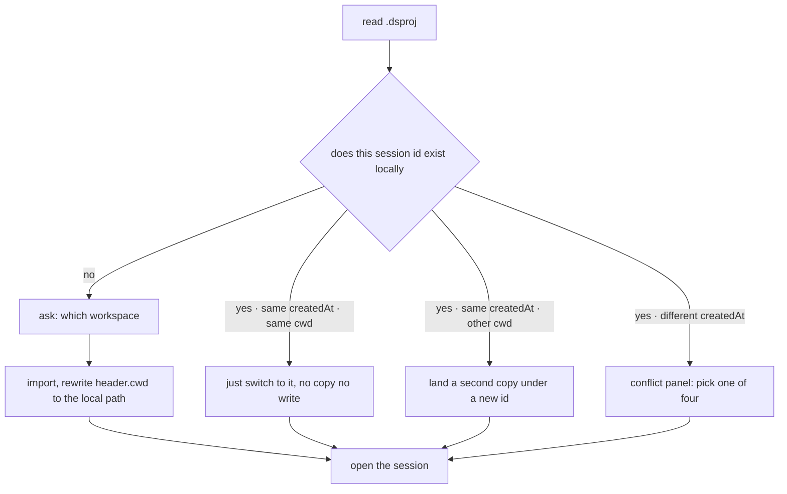

<p align="center">
  
</p>

<h1 align="center">dsh-session-save</h1>

<p align="center">
  Save any DSH session as a single <code>.dsproj</code> project file — save like a document, carry it like a project.<br>
  Open it on another machine or another DSH install and pick the conversation up where it stopped.
</p>

<p align="center">
  <a href="LICENSE"></a>
  
  
  <a href="https://github.com/OWNER/dsh-session-save/stargazers"></a>
</p>

<p align="center">English · <a href="README.md">中文</a></p>


---

## Why

DSH keeps every conversation under `~/.dsh/sessions/` as an append-only zstd frame log. That is reliable, but it has three costs:

- **Moving one conversation means moving a whole tree.** `~/.dsh` holds sessions, memory, attachments, indexes and plugin state — gigabytes of unrelated things.
- **Archiving one conversation means copying an unnamed UUID directory.** Two weeks later nobody remembers which discussion it was.
- **Two machines taking turns is a coin flip.** Syncing `~/.dsh` directly makes indexes, state and logs fight each other.

`dsh-session-save` collapses all of that into one file: **one session = one `.dsproj`**, named after the session title, containing the full history plus the memory of the workspace it belongs to. Sending it to a colleague, dropping it in a synced folder, committing it into a project — all just "one file".

## What it does

Four icons appear in the conversation header:

| Icon | Action | Behaviour |
| :--: | --- | --- |
| 📁 | **Open** | pick a `.dsproj` → import → jump to that session |
| 💾 | **Save** | shows Save As the first time, then overwrites the same file |
| 🔄 | **Autosave** | while on, writes the file at the end of every step |
| 📄✏️ | **Save As** | always asks for a name or location, keeps the original |

The blank-session hero row also gets an "Open" pill, so you can open a project before any conversation exists.


## Install

```bash
# from npm
dsh plugin --profile web add dsh-session-save

# or straight from GitHub
dsh plugin --profile web add github:OWNER/dsh-session-save
```

**Restart DSH afterwards** — plugins are composed at startup. On Windows the native dialog uses `powershell.exe`; without it (Linux, remote shells) the UI falls back to an in-page path field, so nothing is lost.

<details>
<summary>Manual install (for development)</summary>

```powershell
# 1) link the repo into the profile
New-Item -ItemType Junction -Path "$env:USERPROFILE\.dsh\profiles\web\node_modules\dsh-session-save" -Target "<repo>"
# 2) profile package.json → dependencies: "dsh-session-save": "link:<repo>"
# 3) profile package.json → dsh.profile.bundles: append "dsh-session-save"
# 4) restart DSH
```

Do not just add an `- id/name` row to the profile's `cordis.patch.yml` — that file only overrides existing ids; new plugins need `dsh.bundle.patch` plus `dsh.profile.bundles`.

</details>

## Three steps

1. Hit 💾 mid-conversation (or hit 🔄 for autosave — it saves once first).
2. Confirm the name — the default is "session title + creation time", e.g. `dsh-session-save-20261025-1043.dsproj`.
3. Every later 💾 overwrites that file; 📄✏️ makes a copy under a new name.

On the other machine: click 📁, pick the file, the session appears and the UI switches to it.

## How files are named

```
<session title>-<YYYYMMDD-HHmm>.dsproj
```

- The title is the newest `session/title` event (whatever DSH called it).
- The timestamp is the session's **creation** time, not the save time — saving the same session twice always yields the same name.
- `\ / : * ? " < > |` and control characters become spaces, runs collapse, 60 characters max.
- A session without a title falls back to `20261025-1043-session-7f3a2c91.dsproj` (time + first 8 id characters).
- The directory is the last used one, Desktop on the first run.
- **Overwriting never renames**: the full path is remembered, so a later retitle does not spawn a new file.

## What happens on open



- **Ids must be unique per `DSH_HOME`**, so landing the same session in a different workspace issues a new id instead of duplicating it.
- **A missing workspace path** falls back to the host's current directory; only frame 0 (the header) is rewritten, frames 1..n are copied byte for byte.
- **Memory files are compared by sha256**: identical ones are skipped, different ones are written as `xxx.from-dsproj-<date>` — local memory is never overwritten.
- A successful open remembers that `.dsproj` as the session's save target.

The conflict panel shows both sides (title, creation time, size, workspace / exporting machine) with four choices: **cancel**, **save as a copy**, **overwrite local** (after a `.bak-<timestamp>`), **use local**.

## Two machines, synced folders, autosave

Three layers of protection:

**1. A lock inside the file.** Every package carries `LOCK.json` (`host`, `pid`, `at`, `writes`), mirrored into `manifest.json` and summarised in `SUMMARY.md`.

**2. A sidecar lock on disk.** `${file}.lock` is claimed with an exclusive `wx` create; a live pid on this host blocks, a foreign `at` within 15 minutes blocks, otherwise the write proceeds. A block returns `409 locked` naming the holder.

**3. A content fingerprint (CAS).** Each write records the file's sha256. Before the next write it is recomputed; if it differs, the file changed elsewhere:

- manual save → `409 stale` and a panel offering **overwrite on disk** / **save as a new file** / **cancel**;
- autosave → **turns itself off** for that session and writes nothing.

Writes are **atomic** (tmp file + rename) so a sync client never picks up half a package. Paths inside OneDrive / Dropbox / Google Drive / iCloud / Nutstore / Box / Syncthing / Seafile / Baidu Netdisk trigger a warning that two machines with autosave on will overwrite each other — a warning, not a block.

> **In short**: if two machines really take turns on one file, keep **autosave on one of them only**; the other machine will be stopped by the content check.

## Inside a `.dsproj`

A `dshproj/1` ZIP, byte-compatible with the `dshproj` CLI (same package format; the CLI itself lives elsewhere):

```
manifest.json                      metadata + per-entry sha256 + lock mirror
LOCK.json                          who wrote it, when, how many writes
session/session.v4.jsonl.zstd       the raw session log (zstd frames untouched)
memory/workspaces/<slug>/**         that workspace's project memory
SUMMARY.md                          human-readable digest
```

Offline, without DSH:

```bash
dshproj verify   session.dsproj                     # frame structure + entry hashes
dshproj info     session.dsproj                     # title, frame count, memory files
dshproj import   session.dsproj --cwd D:\elsewhere  # import under a new id
```

Code files are not included — a `.dsproj` holds the conversation and its memory. Use `dshproj export --files` to carry the workspace too.

## FAQ

**Does it save what I just typed?** It saves what is already on disk; the step in flight may miss its last frame — click once more when it finishes.

**Is autosave expensive?** Each write re-packs the whole package (the log itself is append-only), debounced to at most one write per 1.5 s per step. For very large sessions prefer manual saves.

**Linux / macOS?** The host side is platform-neutral; the Save As dialog is PowerShell-only and falls back to an in-page path field.

**Will it clobber my memory files?** No — sha256 comparison, conflicts become `xxx.from-dsproj-<date>`.

**Why did the id change after opening?** Because ids must be unique per `DSH_HOME`; the same session landing in a new workspace gets a fresh one and both histories survive.

**Export without importing?** Yes, it is just a ZIP — read it with `dshproj verify/info`.

## Compatibility and versioning

| Line | Where | When it moves |
| --- | --- | --- |
| package | `version` in `package.json` (SemVer) | on `0.x`, MINOR may break, PATCH fixes bugs |
| package format | `dshproj/1` (`FORMAT`) | only when the layout changes |
| lock format | `dshproj-lock/1` (`LOCK_FORMAT`) | only when `LOCK.json` gains fields |
| host range | `engines.dsh`, peer `@deepseek-ai/cordis` | when new APIs or upstream bumps require it |

```bash
node scripts/bump.mjs patch     # bug fix
node scripts/bump.mjs minor     # feature
node scripts/bump.mjs major     # breaking
```

## Development

Zero runtime dependencies, plain ESM, `node:` builtins only; the client half only needs `react`.

```bash
node --check index.js client.js   # syntax
node test/client.mjs              # client wiring: five slot items, icon fingerprint, routes
node test/smoke.mjs               # pack a real session, read the ZIP back, save twice
node test/open.mjs                # open paths: reuse / new cwd / need-workspace / frame diff
node test/conflict.mjs            # locks, four conflict modes, CAS, autosave (~30 s)
node test/dialog.mjs              # Chinese paths through PowerShell result files
```

Every test snapshots and restores `~/.dsh/sessions` and `~/.dsh/memory/workspaces`, so runs leave no residue. Read [`AGENTS.md`](AGENTS.md) before touching code — nine hard rules, the four host routes, the `importPackage` branch order and testing recipes all live there.

## Known limits

- Only `dshproj/1` packages are accepted; a package without a `session/` entry errors out instead of creating an empty session.
- Session switching needs `uiWorkspace.openSession`; front ends without it still import the session, they just do not navigate.
- The cross-machine lock is a 15-minute window, not a heartbeat: a just-finished foreign writer can block you for up to 15 minutes.
- Two instances sharing one `DSH_HOME` overwrite `storages/session-save.json` last-write-wins, though each session keeps its own remembered path.
- The "which workspace" list comes from `storages/workspace.json`; a fresh machine has none, so use "choose another folder…".
- The hero "Open" button only shows on a session with no messages yet; inside a conversation use the header 📁.

## License

MIT © 2026 OWNER · see [LICENSE](LICENSE)
