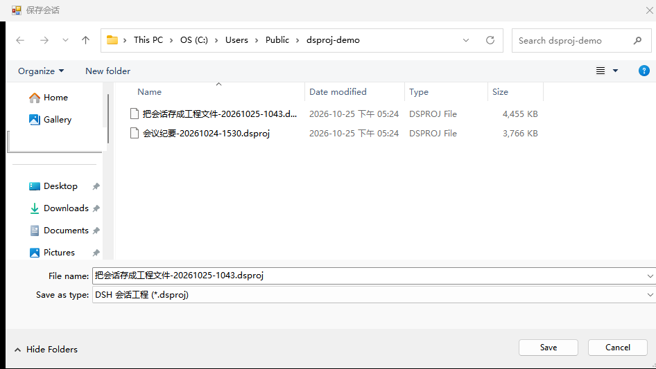
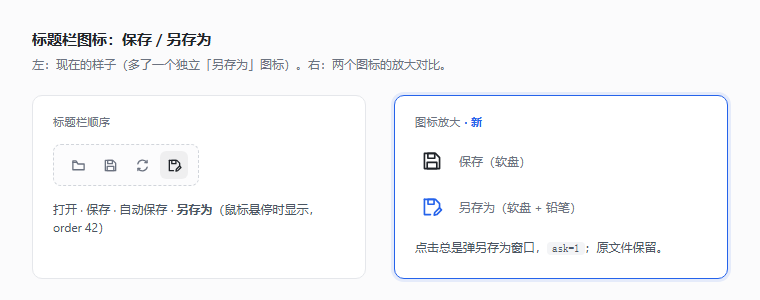
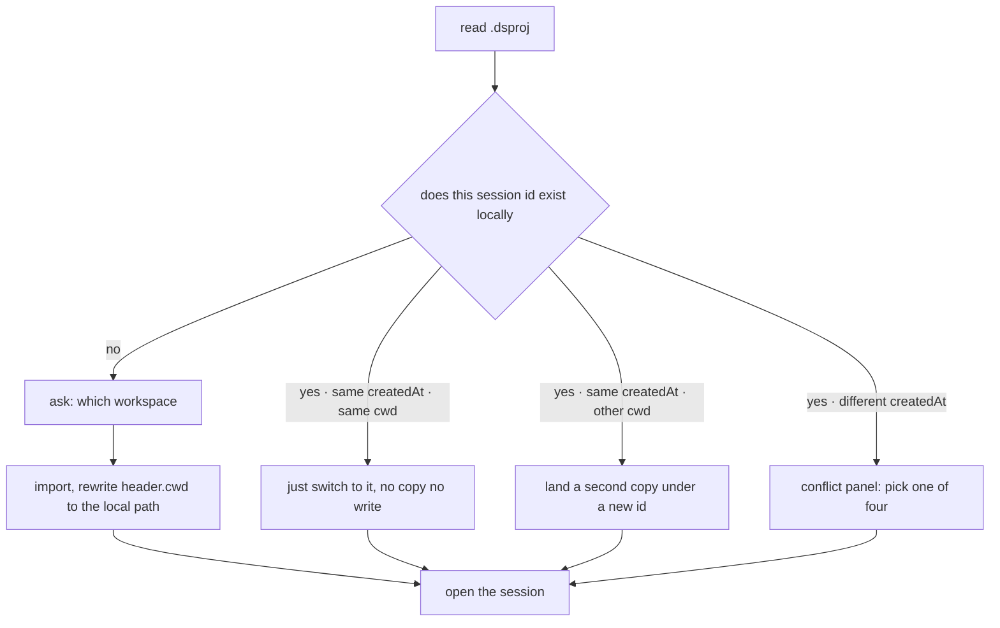

<p align="center">
  
</p>

<h1 align="center">dsh-session-save</h1>

<p align="center">
  Save any DSH session as a single <code>.dsproj</code> project file — save like a document, carry it like a project.<br>
  Open it on another machine or another DSH install and pick the conversation up where it stopped.
</p>

<p align="center">
  <a href="LICENSE"></a>
  <a href="https://www.npmjs.com/package/dsh-session-save"></a>
  
  
  <a href="https://github.com/chinacaa/dsh-session-save/actions/workflows/publish.yml"></a>
  <a href="https://github.com/chinacaa/dsh-session-save/stargazers"></a>
</p>

<p align="center">
  <sub>listed on</sub><br>
  <a href="https://dsh-plugin.org/plugins/chinacaa/dsh-session-save"></a>
  <a href="https://dshfind.com/plugins/chinacaa/dsh-session-save"></a>
  <a href="https://deepseek1024.com/plugins/chinacaa/dsh-session-save"></a>
  <a href="https://dsh.market/"></a>
  <a href="https://awesome-dsh-plugin.com/p/chinacaa/dsh-session-save/"></a>
</p>

<p align="center">English · <a href="README.md">中文</a></p>



---

## Core features and use cases

DSH keeps every conversation under `~/.dsh/sessions/` as an append-only zstd frame log. That is reliable, but it has three costs:

- **Moving one conversation means moving a whole tree.** `~/.dsh` holds sessions, memory, attachments, indexes and plugin state — gigabytes of unrelated things.
- **Archiving one conversation means copying an unnamed UUID directory.** Two weeks later nobody remembers which discussion it was.
- **Two machines taking turns is a coin flip.** Syncing `~/.dsh` directly makes indexes, state and logs fight each other.

`dsh-session-save` collapses all of that into one file: **one session = one `.dsproj`**, named after the session title, containing the full history plus the memory of the workspace it belongs to. Sending it to a colleague, dropping it in a synced folder, committing it into a project — all just "one file".

Four icons appear in the conversation header:

| Icon | Action | Behaviour |
| :--: | --- | --- |
| 📁 | **Open** | pick a `.dsproj` → import → jump to that session |
| 💾 | **Save** | shows Save As the first time, then overwrites the same file |
| 🔄 | **Autosave** | while on, writes the file at the end of every step |
| 📄✏️ | **Save As** | always asks for a name or location, keeps the original |

The blank-session hero row also gets an "Open" pill, so you can open a project before any conversation exists.



## Quick start

1. Hit 💾 mid-conversation (or hit 🔄 for autosave — it saves once first).
2. Confirm the name — the default is "session title + creation time", e.g. `save-session-as-project-20261025-1043.dsproj`.
3. Every later 💾 overwrites that file; 📄✏️ makes a copy under a new name.

On the other machine: click 📁, pick the file, the session appears and the UI switches to it.

## File naming and save protection

```
<session title>-<YYYYMMDD-HHmm>.dsproj
```

- The title is the newest `session/title` event (whatever DSH called it).
- The timestamp is the session's **creation** time, not the save time — saving the same session twice always yields the same name.
- `\ / : * ? " < > |` and control characters become spaces, runs collapse, 60 characters max.
- A session without a title falls back to `20261025-1043-session-7f3a2c91.dsproj` (time + first 8 id characters).
- The directory is the last used one, Desktop on the first run.
- **Overwriting never renames**: the full path is remembered, so a later retitle does not spawn a new file.

### Existence protection on save

The target of a save is *the file at that path*, not *the path*. So every write checks first that the file is still there:

- **Manual save** finds it gone (deleted, moved, or the drive / network folder is not mounted) → a panel shows the original path and offers **create it here** / **save somewhere else** / **cancel**. Nothing is written by default — no same-named empty shell left behind.
- **Autosave** finds it gone → **turns itself off** and tells you why (with the path); that round writes nothing.
- The whole **folder** missing (an unmounted network drive, say) behaves the same: "target folder does not exist" instead of quietly `mkdir -p`-ing the directory and the file back into existence.

## Open and import flow



- **Ids must be unique per `DSH_HOME`**, so landing the same session in a different workspace issues a new id instead of duplicating it.
- **A workspace path that does not work is fixed in place first.** That path comes from the package itself and is often stale after a machine move. Three cases, none of which require you to touch a file manager: ① the folder is gone → the panel offers **create it here and continue**, and it is only created once you click; ② a regular **file** sits at that name → it offers **rename that file and make the folder**, and the file is renamed to `<name>.bak-<timestamp>` and kept (not one byte deleted); ③ neither applies (relative path, drive root, no permission) → the workspace panel opens so you can pick an existing workspace or "Choose another folder…". Called straight from the API with no UI confirmation, nothing is created, renamed or written.
- When a session does land in a different workspace, only frame 0 (the header) is rewritten; frames 1..n are copied byte for byte.
- **Memory files are compared by sha256**: identical ones are skipped, different ones are written as `xxx.from-dsproj-<date>` copies in the default mode — nothing local is overwritten unless you explicitly choose Merge memory.
- A successful open remembers that `.dsproj` as the session's save target.

The conflict panel shows both sides (title, creation time, size, workspace / exporting machine) with four choices: **cancel**, **save as a copy**, **overwrite local** (after a `.bak-<timestamp>`), **use local**.

## Multi-machine sync and concurrency protection

Three layers of protection:

**1. A lock inside the file.** Every package carries `LOCK.json` (`host`, `pid`, `at`, `writes`), mirrored into `manifest.json` and summarised in `SUMMARY.md`.

**2. A sidecar lock on disk.** `${file}.lock` is claimed with an exclusive `wx` create; a live pid on this host blocks, a foreign `at` within 15 minutes blocks, otherwise the write proceeds. A block waits briefly and checks again — the other write has usually finished by then — and only returns `409 locked` (naming the holder) if the file is still held. The dialog adds a **Save anyway** button: the lock only says *someone may be writing*, and whether to overwrite is your call.

**3. A content fingerprint (CAS).** Each write records the file's sha256. Before the next write it is recomputed; if it differs, the file changed elsewhere:

- manual save → `409 stale` and a panel offering **overwrite on disk** / **save as a new file** / **cancel**;
- autosave → **turns itself off** for that session and writes nothing.

Writes are **atomic** (tmp file + rename) so a sync client never picks up half a package. Paths inside OneDrive / Dropbox / Google Drive / iCloud / Nutstore / Box / Syncthing / Seafile / Baidu Netdisk trigger a warning that two machines with autosave on will overwrite each other — a warning, not a block.

> **In short**: if two machines really take turns on one file, keep **autosave on one of them only**; the other machine will be stopped by the content check.

### Opening it un-archives the session

If DSH has this session archived, importing it also restores it. The archive list gates waking a session: the file is there and the workspace knows it, but clicking does nothing. The plugin clears that entry after a successful import and says so in the status line, so you do not have to hunt for it in the sidebar.

When the workspace plugin is not installed this step is skipped and the import still completes.

### Opening it from another machine

When DSH is not served from a loopback address (LAN IP, hostname, reverse proxy), the plugin moves files through the browser:

| Action | Behaviour |
| --- | --- |
| Save | The server only packages, and the browser receives the file. Nothing is written on the server disk and no native dialog opens on that machine. |
| Open | The browser uploads the chosen file's bytes, the server stages them in a temp file, then runs the same verification, health check and conflict rules. The temp file is removed afterwards. |
| Save as | Not shown. Save already downloads, and a second entry point only suggests the file lands somewhere else. |
| Autosave | Not shown. That switch writes a file on the server machine, which the user cannot see or take away. |

So a remote session shows exactly two icons: open and save.

Origin checking is not relaxed: with a non-loopback Host the rule becomes same-origin: requests from other sites still get 403, and `cross-site` fetch metadata is rejected outright.

## Package format and offline tools

A `dshproj/1` ZIP, byte-compatible with the `dshproj` CLI (same package format; the CLI itself lives elsewhere):

```
manifest.json                      metadata + per-entry sha256 + lock mirror
LOCK.json                          who wrote it, when, how many writes
session/session.v4.jsonl.zstd       the raw session log (zstd frames untouched)
memory/workspaces/<slug>/**         that workspace's project memory
attachments/objects/<2>/<sha256>    images the session references (stored by content hash)
attachments/files/<2>/<sha256>      other files it references (same scheme)
SUMMARY.md                          human-readable digest
```

Offline, without DSH:

```bash
dshproj verify   session.dsproj                     # frame structure + entry hashes
dshproj info     session.dsproj                     # title, frame count, memory files
dshproj import   session.dsproj --cwd D:\elsewhere  # import under a new id
```

### Image and attachment packaging

The session log only carries `sha256:` references; the bytes live in a separate object store under `~/.dsh/attachments/v1`. Let the two drift and you get the "attachment missing" error — and retrying does not heal it, because the reference is a fixed hash and the retry asks for the same hash again. So packaging now walks the references the session actually makes and stores those objects under `attachments/`, re-hashing each one on the way in and dropping anything that does not match.

Opening applies the same rule in reverse: an object that already exists is skipped (content addressing is idempotent, so two packages carrying the same image cannot fight); an entry whose shard does not match its hash prefix, or whose content does not hash to its name, is refused. Objects this machine never had are listed in `manifest.attachments.missing` and repeated in `SUMMARY.md`, so the recipient knows up front that this package is missing a few images instead of discovering it in a wall of errors.

Code files are not included — a `.dsproj` holds the conversation, its memory and its attachments. Use `dshproj export --files` to carry the workspace too.

### The compression block travels too

If billion-context (bili) is installed, it remembers per session which messages it has already folded into summaries. That state lives in bili's own directory, not in the DSH session file. So a session packaged on its own arrives at bili as a session it has never seen: with no fold history, the first turn has to resend the whole thing, and the longer the session the more likely that blows the context window. bili turns DSH's native compaction off, so nothing else covers this.

The package now carries `bili/session.json`, and import writes it back under the same naming rule:

| Situation | What happens |
| --- | --- |
| The package has no such entry (old package, or bili was not installed when exported) | Opens normally, `bili.reason` is `absent` |
| bili is not installed here | Opens normally, reason `not-installed` |
| The block's `schema` is not one this version knows | Nothing is written, reason `schema-mismatch`: better to skip than to push an unreadable state into someone else's store |
| The local copy is newer than the packaged one | Left alone, reason `newer-local`: the local copy holds turns from after the export |
| The block names a different session than the one being imported | Nothing is written, reason `session-mismatch`: only this session is restored, nothing else is touched |
| bili wrote that file within the last 2 seconds | Waits once, then backs off, reason `busy`: it is working on this session and would overwrite the restore |
| Normal restore | Written back (existing file kept as `.bak-<time>`), read back and verified, reason `ok` |

```

## Security and data health check

Opening someone else's `.dsproj` is accepting a compressed archive from a stranger, so the plugin treats every package as potentially hostile:

- **Entry-name traversal**: every path segment is validated; `../../x`, `..\..\x`, drive letters and UNC prefixes are rejected at read time, and each memory write target is re-joined and re-checked to stay inside the memory root.
- **Landing filenames**: the session filename declared in `manifest.json` must match `session[.tag].jsonl[.zstd]`, only its basename is used, the target must stay under `~/.dsh/sessions`, and an existing file is never overwritten.
- **Zip bombs**: 64 MB per entry, 512 MB per package, 200× compression ratio (not applied below 4 MB), with the central-directory lengths checked before inflating. **A session log is a concatenation of zstd frames, so each frame is capped at 64 MB after inflation and the whole log at 512 MB** — the zip limits only count what the deflate layer yields, and a second compression layer inside a frame slips past them (a 29 KB package inflated to 900 MB in testing).
- **Write targets**: saving is limited to the last used directory, the directory of an already-remembered file, or a location picked in the native dialog. Anything else — or overwriting a file this plugin did not produce — asks first.
- **Route gate**: all four `/api` routes require a loopback host (`127.0.0.1` / `localhost` / `::1`), a same-origin `Origin`, and a non-`cross-site` request; `sessionId` is shape-checked; failures never echo an absolute path.
- **Package integrity**: every `manifest.parts` entry is verified by sha256 and byte count, and mismatches refuse the import. Conversely, **every content entry (`session/`, `memory/workspaces/`, `attachments/`) must be declared in `manifest.parts`** — undeclared entries are refused, so a package cannot declare only its session and smuggle a `MEMORY.md` into your project notes.

### Pre-open health check and automatic repair

A package may come from another machine, and files may have been deleted along the way. So before an import is written to disk, the session gets scanned once and whatever can be fixed is fixed:

- **Image bytes not on this machine** → that spot becomes a readable line of text (`[image lost: page-2.png]`). Keeping a dangling reference only gets you a wall of `Attachment object is missing.` that retrying never repairs.
- **Image present but missing width/height/bytes** → filled in from the image header (PNG / GIF / WebP / JPEG).
- **A log line that will not parse** → that line is dropped; the rest of the events in the same record stay.
- **A frame that will not decompress** → its bytes are kept as-is with a note. Nothing of yours is thrown away.

Afterwards the UI lists what changed (how many images were missing, how many sizes were filled, how many lines were dropped). Only frames that actually changed are recompressed; untouched frames stay byte-identical — a repaired package is the same session, not a regenerated one. To inspect without changing anything, call `repairSession(buf, { keepMissing: true })`.

### A broken package gets rescued first, and a repair brief if that fails

A `.dsproj` arrives from someone else and can lose a layer in transit, in a sync folder, or to a hand edit. The old behaviour rejected the whole package on the first mismatch, and all you got was "package check failed" — no idea what broke, no way to fix it.

Two steps now:

1. **Try the lenient pass first** (the "drop broken entries and open" button, `?repairPackage=1` on the API). Instead of rejecting everything, the verifier drops just the entries that fail — hash mismatch, size mismatch, undeclared in `manifest.parts`, name outside the allowlist — imports the rest, and reports exactly which entries were dropped and why. As long as `session/` survives, the conversation survives; a lost image or memory file only costs that one file.
2. **If even that fails, hand over a brief** (`package-broken`). A read-only text box shows a paragraph you can copy as-is: where the package is, its size, the plugin version, the verifier's exact error, the first 60 entries, the package format contract, and the five-step fix (recompute sha256 → repair `manifest.parts` → delete the bad entries → repack → list what changed). Paste it into any AI and it can do the repair — you never have to read a zip structure yourself.

Two limits: if `session/` is the broken entry, there is nothing left to rescue and you get the brief instead of an import; and "this package came from a newer version" is a different case (next section), never treated as corruption.

### A large session gets trimmed to a budget first

A few hundred turns add up to hundreds of thousands — or tens of millions — of tokens. Open one of those and the first request fills the context; an incremental compressor like `billion-context` cannot save it either, because it tracks which messages it has already folded per session, and a session that arrives from elsewhere has no history on this machine. The first request ships the whole thing.

So the import measures the session first (decompressed bytes divided by 3.2). Above **150000 tokens** the report says how much the whole conversation would cost and how many trailing turns a budget would keep — but **the file written to disk is still the complete session**. Trimming is advice for this one load, not an edit to your archive; what actually bounds the context is the runtime (billion-context folding, DSH loading).

- Only whole turns are dropped: a tool call never gets separated from its result.
- The file written to disk is the complete session; the `.dsproj` stays byte-for-byte untouched. The keep-count in the report is a suggestion for that one load, and nothing is missing from the archive.
- Turn the report off with `?contextBudget=0`, or pick another budget with `?contextBudget=300000`.
- The UI says "N earlier turns kept out of the context"; this never happens silently.


### Version awareness and upgrade notice

When a package carries entries this version does not recognise, the answer used to be a bare "unknown entry, refusing to open". That sends you the wrong way: you assume the file is damaged, go dig out a backup, save it again — when the real cause is just an old plugin.

Packages now record the plugin version that wrote them (`manifest.plugin`), and opening compares the two first:

- **Package newer than your plugin** → say so plainly: which version wrote it, which version you have, upgrade before opening — and make it clear the package itself is fine.
- **Same version, unfamiliar entry** → still refused as an unknown entry. That is usually a package assembled by some other tool, not a version problem, so "you are old" would be a lie.
- **Old package with no version field** → inferred from the entry prefix (`attachments/` only exists from 0.3.0), so you still get "upgrade" instead of "broken".

Paths on your machine never appear in that message.

### Memory protection: off by default; copies by default, merge overwrites

- **Memory is not packaged by default.** `~/.dsh/memory` holds your project notes, logs and whiteboard; not a byte of it goes into the package unless you hold <kbd>Alt</kbd> while clicking save/save-as, or pass `?memory=1`.
- **Opening a package that carries memory writes it as `xxx.from-dsproj-<date>` copies by default** — DSH will not read them as memory. After opening, the UI reports how many files landed as copies and how many clash with local names, with a panel offering **Merge memory** and **Open memory folder**.
- **Merge memory (`?memory=restore`) only overwrites files that already exist locally with different content**, backing each one up as `xxx.bak-<timestamp>` first. Files this machine does not have are **not written at all** — they are only listed in the dialog's "will be created" section.
- **To spread memory onto a fresh machine**, tick **Merge and create** in the same dialog (`?memory=new`); only then may original names be written.
- **A landing directory matches only by segment-wise equality.** The memory folder is derived from the workspace path (`projectKey`) and looked up through two exact candidates — **no case / dash / trailing-separator normalisation**. `...\ws` and `...\ws\` are two different workspaces; they used to collapse into one, and `restore` could overwrite somebody else's `MEMORY.md` through that crack. The merge dialog now prints the `memoryDir` it is about to use and says the landing spot comes from the package's cwd, not from the workspace you have open.
- **Why so strict**: the `sha256` values in `parts` are **computed by the packager**. A poisoned `MEMORY.md` can be registered there with a matching hash and pass every check above — self-consistency is not trust. So "will DSH read this as memory" is broken only by renaming the landing file. Poisoning can therefore land in exactly two places: a file you already had (with a visible backup), or a new file you explicitly approved with Merge and create.

## Install and cross-platform support

```bash
# from npm
dsh plugin --profile web add dsh-session-save

# or straight from GitHub
dsh plugin --profile web add github:chinacaa/dsh-session-save
```

**Restart DSH afterwards** — plugins are composed at startup. The native Save As dialog picks an implementation per platform: `powershell.exe` on Windows, the built-in `osascript` on macOS, and whichever of zenity / kdialog / qarma / matedialog exists on Linux and the BSDs. With none of them (headless servers, remote shells, slim images) the UI falls back to an in-page path field, so nothing is lost.

<details>
<summary>Manual install (for development)</summary>

```powershell
# 1) link the repo into the profile
New-Item -ItemType Junction -Path "$env:USERPROFILE\.dsh\profiles\web\node_modules\dsh-session-save" -Target "<repo>"
# 2) profile package.json → dependencies: "dsh-session-save": "link:<repo>"
# 3) profile package.json → dsh.profile.bundles: append "dsh-session-save"
# 4) restart DSH
```

Do not just add an `- id/name` row to the profile's `cordis.patch.yml` — that file only overrides existing ids; new plugins need `dsh.bundle.patch` plus `dsh.profile.bundles`.

</details>

## FAQ

**Does it save what I just typed?** It saves what is already on disk; the step in flight may miss its last frame — click once more when it finishes.

**Is autosave expensive?** Each write re-packs the whole package (the log itself is append-only), debounced to at most one write per 1.5 s per step. For very large sessions prefer manual saves.

**Linux / macOS?** Yes. The host side is platform-neutral and the Save As / Open dialogs are picked per platform: WinForms panels through `powershell.exe` on Windows, Finder panels through `osascript` (`choose file name` / `choose file`) on macOS, and the GTK or KDE panel of the first tool found among zenity → kdialog → qarma → matedialog on Linux and the BSDs. With none of them the UI falls back to an in-page path field.

**Can it keep a copy of the old file when overwriting?**

Yes, and it does by default. The conflict panel, the "this file changed on disk" prompt and the memory merge dialog all carry a "Back up the original before overwriting" checkbox; leave it ticked and it writes a `.bak-<time>` copy, clear it and nothing is kept. The same applies when saving over an unrelated file that happens to have the same name.

**I deleted the file — what happens if I hit 💾 now?** It stops and asks instead of silently creating a new one. The panel offers **create it here** (start a fresh package at the old path), **save somewhere else** (leave the old path alone), or **cancel** (write nothing). If autosave was on, it turns itself off and says so.

**Will it clobber my memory files?** Memory is not packaged by default; when it is, importing writes `xxx.from-dsproj-<date>` copies; Merge memory only touches files you already have, after a `.bak-<timestamp>` backup.

**Why did the id change after opening?** Because ids must be unique per `DSH_HOME`; the same session landing in a new workspace gets a fresh one and both histories survive.

**Export without importing?** Yes, it is just a ZIP — read it with `dshproj verify/info`.

## Compatibility and versioning

| Line | Where | When it moves |
| --- | --- | --- |
| package | `version` in `package.json` (SemVer) | on `0.x`, MINOR may break, PATCH fixes bugs |
| package format | `dshproj/1` (`FORMAT`) | only when the layout changes |
| lock format | `dshproj-lock/1` (`LOCK_FORMAT`) | only when `LOCK.json` gains fields |
| host range | `engines.dsh`, peer `@deepseek-ai/cordis` | when new APIs or upstream bumps require it |

Host range each release actually declared (verify with `npm view dsh-session-save@<version> engines --registry=https://registry.npmjs.org`):

| Plugin | `engines.dsh` | Note |
| --- | --- | --- |
| 0.2.3 | `>=0.2.1-rc.1` | no upper bound |
| 0.3.0 | `>=0.2.1-rc.1` | no upper bound; first release that packs attachments |
| 0.4.0 | `>=0.2.1-rc.1 <0.3.0-0` | upper bound added |
| 0.4.1 | `>=0.2.1-rc.1 <0.3.0-0` | same |

The lower bound never moved: the attachment object layout that 0.3.0 depends on (`attachments/v1` with `objects`/`file-objects` shards) already exists in `@deepseek-ai/dsh-attachment-local@0.2.1-rc.1` (10 hits in that package), so it did not raise the floor. **The upper bound only arrived in 0.4.0** — earlier versions are not blocked by `engines` on dsh 0.3.x and will not error, but nobody has checked whether the APIs they use still exist. On dsh 0.3.0 and newer, use 0.4.x.

```bash
node scripts/bump.mjs patch     # bug fix
node scripts/bump.mjs minor     # feature
node scripts/bump.mjs major     # breaking
```

Commit, tag, push the tag — publishing takes care of itself. `publish.yml` runs the whole chain:

```bash
git commit -am "release vX" && git tag -a vX -m "vX"
git push origin main && git push origin vX
```

Publish to npm (with provenance) → pull that exact tarball back from the registry and verify its sha1 → create the GitHub Release from this version's `CHANGELOG.md` section → attach the tarball to the Release. **No hand-written release notes and no manual Release step**: `CHANGELOG.md` is the single source, and `node scripts/release-notes.mjs <version>` extracts the right section for you.

Re-running the same tag is safe: if the version is already on npm the publish is skipped, an existing Release is left alone, and the attachment is overwritten. So an earlier run that failed to attach the tarball is fixed by simply re-running.

## Interface language

UI text does not live in the code; it lives in `locales/`:

```
locales/
├── zh-CN.json   source language, 121 keys; add new strings here
└── en-US.json
```

At startup the plugin serves the packs from `/api/session.locales`; the client picks one by `navigator.language` and falls back to Chinese. `client.js` still carries a Chinese table as the first-paint fallback — the pack is fetched asynchronously, and waiting for it would mean a blank window.

To add a language: copy `zh-CN.json` to `xx-XX.json`, translate the values, then run

```bash
node scripts/check-locales.mjs
```

It reports missing keys and placeholder mismatches. Placeholders (`{n}`, `{path}`, `{name}`) must be kept verbatim — translating them away renders `undefined`. See `locales/README.md` for the details.

## Development

Zero runtime dependencies, plain ESM, `node:` builtins only; the client half only needs `react`.

```bash
node --check index.js client.js   # syntax
node test/client.mjs              # client wiring: five slot items, icon fingerprint, routes (both locales)
node test/smoke.mjs               # pack a fixture session, read the ZIP back, save twice
node test/open.mjs                # open paths: reuse / new cwd / need-workspace / frame diff
node test/conflict.mjs            # locks, four conflict modes, CAS, autosave (~30 s)
node test/dialog.mjs              # three-platform native dialogs: selector + argument assembly + CJK round trip
node test/security.mjs            # traversal / landing names / zip bombs / route gate / parts
node test/pathkey.mjs             # path keys: byte-for-byte check against DSH's own directory naming (run this first after a DSH upgrade)
```

To check the English word list after touching the client: `DSH_TEST_LOCALE=en-US node test/client.mjs`.

Most of the twenty-four suites run against their own temporary `DSH_HOME` (a fixture directory under `os.tmpdir()` built by `test/fixture.mjs`) and delete it afterwards, so **your real `~/.dsh` is never touched** and no session has to "happen to exist".

Three exceptions: `test/client.mjs` is a pure in-memory wiring test with no fixture directory and no disk IO, and `test/pathkey.mjs` only calls two pure functions, so it writes nothing either. In `test/dialog.mjs` the selector checks, the AppleScript / zenity argument assembly and the script BOM checks are pure static verification and run anywhere, while only the few assertions that launch the real `powershell.exe` to verify CJK encoding are skipped off Windows (they print `⏭  跳过` — a skip is not a pass). The other eight are cross-platform.

Read [`AGENTS.md`](AGENTS.md) before touching code — the hard rules, the four host routes, the `importPackage` branch order and testing recipes all live there. [`CLAUDE.md`](CLAUDE.md) is the short entry point and [`docs/TEST-MATRIX.md`](docs/TEST-MATRIX.md) maps every feature to the test that covers it.

## Contributing

### Reporting a bug you can fix

Include these five things, otherwise we mostly go back and forth:

1. Plugin version and DSH version (`node -p "require('dsh-session-save/package.json').version"`);
2. Platform (Windows / macOS / Linux), and whether the native Save As window appears — that decides whether it goes through the native dialog or the in-page path field;
3. Steps to reproduce, starting from which button you clicked;
4. The exact error text: the message on screen, or the `[dsh-session-save]` line in the console. Paste it, do not paraphrase;
5. If a package will not open: does the same `.dsproj` fail on another machine, or under another drive letter.

### Sending a PR

```bash
git clone https://github.com/chinacaa/dsh-session-save
cd dsh-session-save
node test/pathkey.mjs          # make sure the baseline is green; all twelve suites are listed in AGENTS.md
```

- **Zero runtime dependencies is a hard rule**: do not add anything to `dependencies`, and the client may only `require('react')`.
- Behaviour changed → add a line to `[Unreleased]` in `CHANGELOG.md`; an assertion or a feature point changed → update `docs/TEST-MATRIX.md` too.
- Copy changed → update the Chinese README, the English README, and `locales/*.json` together; `node scripts/check-locales.mjs` catches the misses.
- Write commit messages in Chinese, one sentence about what changed; one PR, one thing.
- Before pushing, run `node --check index.js client.js` and all twelve test suites. A red PR is not reviewed.

### Adding a language

Every string lives in `locales/`; adding `<language-tag>.json` is enough, no code changes:

1. Copy `locales/zh-CN.json` to `locales/ja-JP.json` (use a BCP 47 tag; for Chinese prefer a region such as `zh-TW`);
2. Translate entry by entry, **keep placeholders `{n}` and `{path}` intact**, add no extra key and drop none;
3. Run `node scripts/check-locales.mjs` — it reports which entries are missing and which placeholders do not match;
4. Open the PR. Partial translations are fine; missing entries fall back to Chinese.

Details in [`locales/README.md`](locales/README.md).

### What not to send

- No CLA to sign, and no need to open an issue first.
- Do not touch `version` in `package.json`: releases are cut by pushing a tag.
- No "convert to TypeScript", "add a build step", or "use some UI library" PRs. Zero dependencies and no build step are deliberate: the plugin is composed at DSH startup, so installing and restarting is all a user does.

## Known limits

- Only `dshproj/1` packages are accepted; a package without a `session/` entry errors out instead of creating an empty session.
- Session switching needs `uiWorkspace.openSession`; front ends without it still import the session, they just do not navigate.
- The cross-machine lock is a 15-minute window, not a heartbeat: a just-finished foreign writer can block you for up to 15 minutes.
- Two instances sharing one `DSH_HOME` overwrite `storages/session-save.json` last-write-wins, though each session keeps its own remembered path.
- The "which workspace" list comes from `storages/workspace.json`; a fresh machine has none, so use "choose another folder…".
- The hero "Open" button only shows on a session with no messages yet; inside a conversation use the header 📁.
- Memory is not packaged by default; a package that carries it still lands copies on import until the user explicitly picks Merge memory / Merge and create (see above).
- Loopback only: reaching this DSH through a reverse proxy or from another machine's browser gets the four session routes a 403, by design.

## License

MIT © 2026 chinacaa · see [LICENSE](LICENSE)
