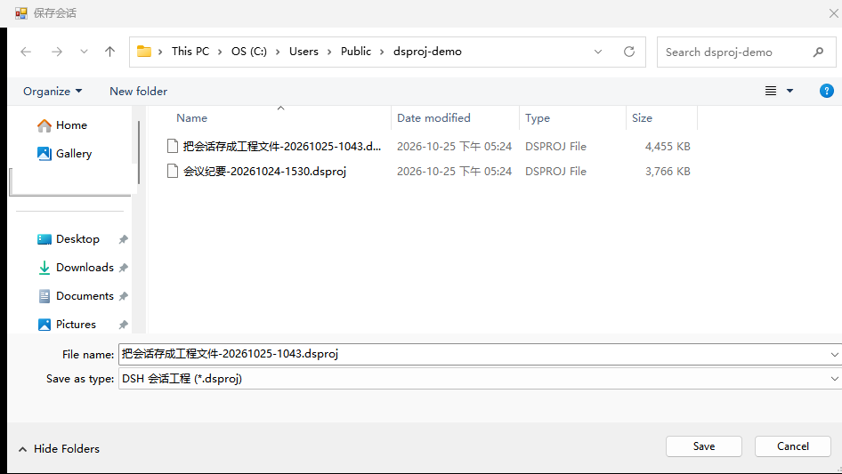
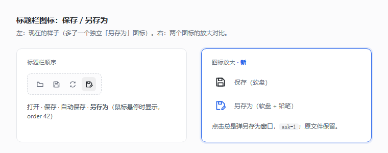
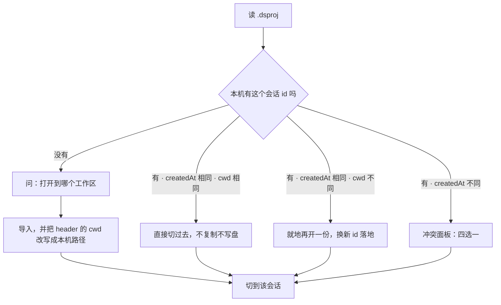

<p align="center">
  
</p>

<h1 align="center">dsh-session-save</h1>

<p align="center">
  把 DSH 会话存成一个 <code>.dsproj</code> 工程文件：像 Word 那样保存，像工程文件那样拷走。<br>
  换个 DSH、换台机器，打开这个文件就能接着上次的话题继续。
</p>

<p align="center">
  <a href="LICENSE"></a>
  <a href="https://www.npmjs.com/package/dsh-session-save"></a>
  
  
  <a href="https://github.com/chinacaa/dsh-session-save/actions/workflows/publish.yml"></a>
  <a href="https://github.com/chinacaa/dsh-session-save/stargazers"></a>
</p>

<p align="center">
  <sub>已上架 · listed on</sub><br>
  <a href="https://dsh-plugin.org/plugins/chinacaa/dsh-session-save"></a>
  <a href="https://dshfind.com/plugins/chinacaa/dsh-session-save"></a>
  <a href="https://deepseek1024.com/plugins/chinacaa/dsh-session-save"></a>
  <a href="https://dsh.market/"></a>
  <a href="https://awesome-dsh-plugin.com/p/chinacaa/dsh-session-save/"></a>
</p>

<p align="center"><a href="README.en.md">English</a> · 中文</p>



---

## 核心功能与使用场景

DSH 把每条会话都记在 `~/.dsh/sessions/` 里，`session.v4.jsonl.zstd` 是追加写的 zstd 帧。这样做很稳，但带来三个麻烦：

- **想带走一条会话，得整目录搬。** `~/.dsh` 里有会话、记忆、附件、索引、插件状态，几个 GB 起步，搬一次等于换整台机器。
- **想存档一条对话，只能手动拷文件。** 拷完是个没有名字的 UUID 目录，过两周就想不起来它是哪次讨论。
- **两台机器轮流用，谁覆盖谁说不清。** 直接同步 `~/.dsh` 会让索引、状态、日志互相打架。

`dsh-session-save` 把这堆东西收成一个文件：**一个会话 = 一个 `.dsproj`**，名字是会话标题，里面是这条对话的全部历史加它所在工作区的记忆与引用附件。发给别人、丢进网盘、归档进项目仓库，都只是"一个文件"的事。

装上后，标题栏右侧多出四个图标：

| 图标 | 动作 | 说明 |
| :--: | --- | --- |
| 📁 | **打开** | 选一个 `.dsproj` → 导入 → 自动切到那个会话 |
| 💾 | **保存** | 第一次弹「另存为」，之后每点一次覆盖同一个文件 |
| 🔄 | **自动保存** | 开着的话，每步结束自动写回那个文件 |
| 📄✏️ | **另存为** | 每次都弹窗口，可以换名字或换位置，原文件保留 |

空会话页面的新会话行右侧还会多一个「打开」胶囊按钮。刚进 DSH、还没有对话时，也能直接开一个工程文件。



## 快速上手

1. 聊到一半点 💾（或者直接点 🔄 开自动保存，它会先替你存一次）。
2. 弹窗里确认文件名，默认是「会话标题 + 会话创建时间」，比如 `把会话存成工程文件-20261025-1043.dsproj`。
3. 之后每点一次 💾 就覆盖它；想留一份快照就点 📄✏️。

在另一台机器上：点 📁 选这个文件，会话会出现在列表里并自动切过去，接着上次的话继续说。

## 文件命名与保存保护

```
把会话存成工程文件-20261025-1043.dsproj
└── 会话标题 ──┘ └─ 创建时间 ─┘
```

- 标题取日志里最新的 `session/title`（DSH 自己起的那个，通常是第一句话或 LLM 的概括）。
- 时间取会话**创建**时间，不是点保存的时间。同一个会话每次另存为都得到同一个名字，不会越存越乱。
- `\ / : * ? " < > |` 和控制字符换成空格，连续空白折叠，最长 60 字。
- 还没起标题的会话退回 `20261025-1043-session-7f3a2c91.dsproj`（时间 + id 前 8 位）。
- 目录用上次保存的目录，第一次是桌面。
- **覆盖保存不改名**：记住的是完整路径，标题后来变了也不会突然冒出一个新文件。

### 保存时的存在性保护

保存的目标是「那个路径上的那个文件」，不是「那个路径」。所以每次写盘之前都会先看它还在不在：

- **手动保存**发现不在了（被删、被移走、磁盘或网盘没挂上）→ 弹窗把原来那个路径摊给你看，三个选择：**就在这里新建**（原路径上重新起一份） / **另存到别处**（换个位置，原路径不碰） / **取消**（什么都不写）。默认什么都不写，不会在空位上放一个同名空壳。
- **自动保存**发现不在了 → **自己关掉自动保存**，并在界面告诉你原因（带原路径），这一轮不写盘。
- 目标**文件夹**整个没了（比如网盘没挂上）也一样：报「目标目录不存在」，不再悄悄 `mkdir -p` 把目录和文件一起造出来。

## 打开与导入流程

点「打开」之后，Host 侧按这个顺序判断（`importPackage()`）：



导入时的交互与落盘行为：

- **本机没有这个会话**：弹窗询问「打开到哪个工作区」，确认后改写 header 里的工作区路径并切过去。打开成功后，这个 `.dsproj` 会被记成该会话的「保存位置」——接着点 💾 就是存回同一个文件。
- **本机已有且完全一致**（`createdAt` 相同且 `cwd` 相同）：直接切过去，不复制也不写盘。
- **同会话换工作区落地**（`createdAt` 相同但 `cwd` 不同）：换新 id 落地（`relocate`），就地再开一份。
- **会话冲突**（`createdAt` 不同）：弹出冲突面板，把两边并排列出来（标题、创建时间、体积、工作区 / 导出机器），四个按钮供选择：

| 按钮 | 做什么 |
| --- | --- |
| 取消 | 什么都不做 |
| 另存为副本 | 换新 id 落盘，两条历史都留着 |
| 用文件覆盖本机 | 先给本机那份留 `.bak-<时间戳>`，再写回同一目录 |
| 用本机的 | 只切到本机那份，不写盘 |

<details>
<summary>设计考量与实现细节</summary>

- **id 必须全机唯一**：所以「同一会话落到别的工作区」会换新 id（`relocate`），不会出现两份同 id 的会话，两条历史都留着。
- **落点不对时先自己想办法**：打开时要把会话落到包里的工作区路径上（这个路径来自包本身，换台机器后经常已经不在）。分三种情况处理，都不需要你自己去资源管理器里折腾：①目录不存在 → 面板上直接给「在这里新建文件夹并继续」，点了才建；②那个位置被一个同名**文件**占着 → 给「把那个文件改名备份，在原处建文件夹」，文件改名成 `<原名>.bak-<时间戳>` 留着，一个字节都不删；③两种情况都不适用（相对路径、盘符根、没权限）→ 退回工作区面板，选一个已有的工作区，或「选其他目录…」指定。没有界面确认时（直接调接口）一律不建、不删、不写。
- **换工作区落地时只重写 header 那一帧里的 `cwd`**，其余 zstd 帧原字节照搬。
- **记忆文件按 sha256 比对**：相同跳过；不同则写成 `xxx.from-dsproj-<日期>`，**从不覆盖**本机已有记忆（详见后文记忆机制）。

</details>

## 多机同步与并发保护

这是最容易出事的地方，所以有三道防线。

**第一道：文件里的锁。** 每个包都带 `LOCK.json`：

```json
{ "format": "dshproj-lock/1", "sessionId": "…", "host": "…", "pid": 1234, "at": "2026-10-25T09:00:00.000Z", "writes": 7 }
```

`manifest.json` 里镜像一份，`SUMMARY.md` 里写明「写入者 / 锁时间」。`writes` 是这份文件的累计写入次数。

**第二道：系统里的侧车锁。** 写盘瞬间用 `<file>.lock` 以 `wx` 独占创建；抢不到就读持有者，判断是否过期。同机 pid 还活着 → 挡；异机且 `at` 在 15 分钟内 → 挡；其余可写。被挡时先自动等一小会儿再判一轮（对方的写入通常这时已经写完了），仍然占着才返回 `409 locked`，消息里点名占用者，并给一个「仍然保存」按钮——锁只说明「可能有人在写」，要不要盖过去由你判断。

**第三道：内容指纹（CAS）。** 每次写完记下文件的 `sha256`；下次写之前重算，不一致说明这个文件已经被别处改过：

- 手动保存遇到 → `409 stale`，弹「这个文件已被别处改过」，三个选择：**覆盖磁盘上的** / **另存为新文件** / **取消**。
- 自动保存遇到 → **自己关掉自动保存**，这一轮不写盘。绝不用本机内容盖掉对方。

另外每次写盘都是**原子写**（先写 `<file>.tmp-<pid>-<时间戳>` 再 `rename`），同步盘不会抓到写了一半的包。路径落在 OneDrive / Dropbox / Google Drive / iCloud / 坚果云 / Box / Syncthing / Seafile / 百度网盘 时，界面会提示「两台机器同时开着自动保存会互相覆盖，建议只在一台机器上写」——只提示，不阻止。

> **一句话**：真要两台机器轮流用同一份文件，**只在一台机器上开自动保存**；另一台手动保存时，会被内容比对拦下来问你。

## 包格式与离线工具

`.dsproj` 是 `dshproj/1` 格式的 ZIP，和同名的 `dshproj` 命令行工具双向兼容（同一个包格式，工具本体不在这个仓库里）：

```
manifest.json                      会话元数据 + 每个条目的 sha256 + 锁镜像
LOCK.json                          谁写的、什么时候、写了几次
session/session.v4.jsonl.zstd       会话日志原字节（zstd 帧一个不动）
memory/workspaces/<slug>/**         该工作区的项目记忆（笔记 / 交接 / 反思）
attachments/objects/<前2>/<sha256>  会话引用到的图片（按内容哈希存，去重）
attachments/files/<前2>/<sha256>    会话引用到的其它文件（同上）
SUMMARY.md                          人类可读摘要（ID / 工作区 / 帧数 / 行数 / 写入者）
```

不开 DSH 也能用同一个格式离线处理：

```bash
dshproj verify   会话.dsproj                      # 校验帧结构与条目 sha256
dshproj info     会话.dsproj                      # 看标题、帧数、记忆文件数
dshproj import   会话.dsproj --cwd D:\elsewhere   # 导进另一个工作区（换新 id）
```

### 图片与附件打包机制

会话日志里只留 `sha256:` 引用，图片和文件的字节在 `~/.dsh/attachments/v1` 下的独立对象库。两者不同步就会出「附件丢失」——而且重试不会自愈，因为引用指向的是一段固定哈希，重试还是同一段。所以打包时按内容哈希把**会话真正引用到的**对象一起塞进 `attachments/`，读出来先重算哈希，对不上宁可不带。

打开时按同样规则回填：目标已存在就跳过（内容寻址天然幂等，两个包带同一张图不会打架）；条目名与哈希前缀不符、或内容哈希对不上，一律拒绝写入。本机本来就没有的对象记进 `manifest.attachments.missing` 并写进 `SUMMARY.md`——接包的人能提前知道「这个包天生缺几张图」，而不是打开时炸一脸。

不打包工作区里的代码文件——`.dsproj` 只带会话、记忆与附件。要把代码一起带走用 `dshproj export --files`。

## 安全防御与数据体检

打开别人的 `.dsproj` 等于让别人给你递一份压缩包，所以这个插件按「包可能是敌人」来做：

- **条目名穿越**：包里的路径逐段校验，`../../x`、`..\..\x`、盘符、UNC 一律在读包阶段拒绝；记忆文件写入时每条落点重新拼一遍并复核仍在记忆目录内。
- **落盘文件名**：`manifest.json` 里声明的会话文件名只接受 `session[.tag].jsonl[.zstd]` 形态并只取 basename，落点必须仍在 `~/.dsh/sessions` 里，已存在就不覆盖。
- **解压炸弹**：单条目上限 64 MB、整包上限 512 MB、压缩比上限 200×（非附件条目 4 MB 以下不算比例；`attachments/` 是已压缩的二进制、合法包接近 1:1，所以 64 KB 起就要算，不给豁免），并且先校验中央目录里的长度再解压。**会话日志本身是「多个 zstd 帧拼接」，所以每一帧解压后另有 64 MB 上限、整卷累计 512 MB**——zip 那层只算「压缩数据解出来多少」，帧里再套一层就能绕过去（实测一个 29 KB 的包解出 900 MB）。
- **写去哪儿**：保存只允许写到上次用的目录、已记住文件的目录，或原生对话框选的位置。写到别处、或者要覆盖一个不是本插件产出的文件，都要先确认。
- **路由入口**：四条 `/api` 路由只接受回环地址（`127.0.0.1` / `localhost` / `::1`）、同源 `Origin`、非 `cross-site` 请求；`sessionId` 形态校验；失败信息不回显绝对路径。
- **包完整性**：`manifest.parts` 里每条 `sha256` 与字节数逐条复核，不匹配就拒绝导入。反过来说，**内容条目（`session/`、`memory/workspaces/`、`attachments/`）必须都在 `manifest.parts` 里声明过**——没声明的一律拒绝，这样就没法只声明会话、偷偷夹带一份 `MEMORY.md` 塞进你的项目笔记。
- **附件回填**：一次导入最多写 2000 个附件对象、合计 128 MB，超出部分不写，并在打开提示里告诉你少写了几个。附件的落点是 DSH 自己的对象库（`~/.dsh/attachments/v1`），那里没有回收机制，写进去就一直占着磁盘——所以这条额度比整包上限更紧。

### 打开前体检与自动修复

包可能是从别的机器来的，中间也可能有文件被删过。所以**导入落盘之前**先扫一遍，能修的直接修好再存：

- **图片的字节本机没有** → 那个位置换成一行可读的文字（`[图片已丢失：page-2.png]`）。留着一个打不开的引用只会让你打开时看到一排 `Attachment object is missing.`，还重试不好。
- **图片在，但缺宽高/字节数** → 按图片文件头（PNG / GIF / WebP / JPEG）把尺寸补齐。
- **某一行日志解析不了** → 丢掉那一行，同一条记录里的其余事件照常留下。
- **某一帧解压不开** → 原样保留它的字节，只记一笔，不替你丢数据。

改完之后界面会逐条告诉你动了什么（缺几张图、补了几个尺寸、丢了几行）。只重压真的改过的那一帧，没动的帧逐字节不变——所以体检过的包和原来的包是同一份会话，不是重新生成的。想只看不改，可以调 `repairSession(buf, { keepMissing: true })`。

### 包坏了先试着救，救不了给一段能直接交给 AI 的说明

`.dsproj` 是别人打包发来的，可能在传输、网盘同步、手动改动的过程中坏掉一层。校验器一发现不对就整包拒绝，用户拿到的只有一句「包校验失败」——既不知道坏在哪，也没法自己修。

现在分两步：

1. **先试宽松模式**（点「丢掉坏条目后打开」，接口上是 `?repairPackage=1`）。校验器不再整包拒绝，而是逐条判：哈希对不上、体积对不上、没在 `manifest.parts` 里声明、条目名不在白名单——这四类条目**就地摘掉**，其余照常导入，并告诉你摘掉了哪几条、为什么。只要 `session/` 那条还在，对话历史就能救回来；记忆和图片坏了只是少几张。
2. **救不了就给说明**（返回 `package-broken`）。界面上弹一个只读文本框，里面是一整段可以直接复制的说明：包在哪、多大、插件版本、校验器的报错原文、包内条目清单（前 60 条）、包格式约定、以及五步修法（重算 sha256 → 修 `manifest.parts` → 删坏条目 → 重新打包 → 说明改了哪些）。拿着这段去问任何 AI，它都能照着修——不用你自己读懂 zip 结构。

两条边界：`session/` 那条要是坏了或被摘掉，就没有可救的了，只会给说明不会导入；「这个包来自更新版本的插件」是另一种情况（见下一节），不会被当成坏包硬修。

### 版本感知与升级提示

包里有这一版插件不认识的条目时，以前只能回一句「包里有不认识的条目，拒绝打开」。那个提示把人往错的方向推——你会以为文件坏了，去翻备份、重存一份，而真实原因只是插件旧了。

现在包会记下写它的插件版本（`manifest.plugin`），打开时先比一比：

- **包比你的插件新** → 直接说清楚「写它的是哪个版本、你本机是哪个版本、先升级再打开」，并且你一定知道包本身没坏。
- **同一个版本却带了陌生条目** → 仍按「不认识的条目」拒绝。这种情况多半是包被别的工具拼过，不是版本问题，不能拿「你旧了」糊过去。
- **老包没写版本** → 按条目前缀反推（`attachments/` 是 0.3.0 起才有的），照样能给出「该升级了」而不是「文件坏了」。

提示里不会出现你机器上的路径。

### 记忆保护：默认不带；带了默认落副本，合并才覆盖

- **默认不打包记忆**。`~/.dsh/memory` 里有你的项目笔记、日志和白板，默认一个字节都不进包。要连记忆一起带走，按住 <kbd>Alt</kbd> 点保存/另存为，或请求里带 `?memory=1`。
- **包里带着记忆、在别的机器上打开，记忆默认只落成 `xxx.from-dsproj-<日期>` 副本**，DSH 不会把它当记忆读。打开后界面会报「几个文件落了副本 / 几个和本机重名」，并给一块带「合并记忆」「打开记忆目录」的提示面板。
- **「合并记忆」（`?memory=restore`）只覆盖本机已存在、且内容不同的文件**，覆盖前备份成 `xxx.bak-<时间>`；本机没有的一律**一个都不写**，只在弹窗「将新建」段里列给你看。
- **要把记忆铺到一台全新机器**，得在同一个弹窗里额外点「合并并新建」（`?memory=new`），这时才允许落原名。
- **落点只认「路径逐段相同」。** 记忆目录按工作区路径算出来（`projectKey`），查已有目录时只比两级精确候选，**不做大小写 / `-` / 尾分隔符的归一化模糊匹配**——`...\ws` 和 `...\ws\` 是两个工作区，各自的记忆各归各的，防止模糊匹配导致 `restore` 顺着路径覆盖别人的 `MEMORY.md`。合并弹窗里会直接列出这次要落的 `memoryDir`，并写明「落点由包里的 cwd 决定，不是你当前打开的工作区」。
- **为什么这么保守**：`parts` 里的 `sha256` 是**打包方自己算的**，把投毒的 `MEMORY.md` 也登记进去、哈希算对，前面所有校验都过得去——自洽不等于可信。所以「会不会被 DSH 当记忆读」只能靠改落点名来断。于是投毒最多落在两种位置：你本机本来就有、且备份看得见的那份，或者你亲手点过「合并并新建」的新文件。

## 安装与跨平台支持

```bash
# 从 npm 装
dsh plugin --profile web add dsh-session-save

# 或直接从 GitHub 装
dsh plugin --profile web add github:chinacaa/dsh-session-save
```

装完**重启 DSH**：插件在启动时组合，热装不会生效。

### 跨平台原生窗口

Host 侧逻辑与平台无关；另存为/打开窗口按平台挑实现：
- **Windows**：走 `powershell.exe` 的 WinForms 面板。
- **macOS**：走系统自带的 `osascript` 的 Finder 面板（`choose file name` / `choose file`）。
- **Linux / BSD**：按顺序探测 zenity → kdialog → qarma → matedialog，使用找到的第一个的 GTK / KDE 面板。

三者都没有时（无头服务器、纯远程会话、精简镜像）自动退回页面内的路径输入框，功能完整不丢。

<details>
<summary>手动安装（开发时用）</summary>

```powershell
# 1) 把仓库链接进 profile
New-Item -ItemType Junction -Path "$env:USERPROFILE\.dsh\profiles\web\node_modules\dsh-session-save" -Target "<repo>"
# 2) profile 的 package.json → dependencies 加 "dsh-session-save": "link:<repo>"
# 3) profile 的 package.json → dsh.profile.bundles 追加 "dsh-session-save"
# 4) 重启 DSH
```

别只往 profile 的 `cordis.patch.yml` 追加 `- id/name` 行。那份文件只用于**覆盖已有 id**，新增插件走 `dsh.bundle.patch` + `dsh.profile.bundles`。

</details>

## 常见问题

**保存的是我这句话吗？** 保存的是**此刻已落盘**的内容；正在生成的这一步可能还差最后一帧，等它结束再点一次就齐了。

**文件被我删了，再点 💾 会怎样？** 会停下来问你，不会静默新建。详见上文「保存时的存在性保护」，弹窗会提供**就在这里新建** / **另存到别处** / **取消**三选一；自动保存发现文件丢失会自动关闭并告警。

**自动保存会不会很占磁盘？** 每步整包重写（会话日志追加写，但包要重新打包），1.5 秒去抖把频率压到每步最多一次。会话特别大时建议只手动保存。

**能在 Linux / macOS 上用吗？** 能。Host 侧逻辑与平台无关，支持 WinForms、Finder、zenity/kdialog 等原生面板，无图形环境退回 Web 输入框（详见「跨平台原生窗口」一节）。

**会覆盖我的项目记忆吗？** 默认连记忆都不打包；带记忆打开时默认落 `xxx.from-dsproj-<日期>` 副本；点「合并记忆」才会覆盖本机已有文件（覆盖前留 `.bak-<时间>`），点「合并并新建」才在本机没有的地方落原名。

**打开后为什么换了 id？** 因为 id 必须在一个 `DSH_HOME` 内唯一：同一个会话换工作区落地会重新发一个 id，两条历史都在。

**能只导出不导入吗？** 能。`.dsproj` 就是 ZIP，`dshproj verify/info` 都能离线读。

## 兼容与版本

| 项 | 版本线 | 什么时候动 |
| --- | --- | --- |
| 包版本 | `package.json` 的 `version`（SemVer） | `0.x` 时 MINOR 可破坏，PATCH 只修 bug |
| 包格式 | `dshproj/1`（`index.js` 的 `FORMAT`） | 包内布局变了才动，要照顾 `dshproj` 命令行 |
| 锁格式 | `dshproj-lock/1`（`LOCK_FORMAT`） | `LOCK.json` 字段变了才动 |
| 宿主范围 | `engines.dsh`、peer `@deepseek-ai/cordis` | 用了新 API 或官方包抬了下界 |

改版本用脚本，别手改（它会同步 `CHANGELOG.md`）：

```bash
node scripts/bump.mjs patch     # 修 bug
node scripts/bump.mjs minor     # 新功能
node scripts/bump.mjs major     # 破坏性
```

改完提交、打 tag、推 tag，发布就全自动了：打 tag 之后 `publish.yml` 会做完整条链路：

```bash
git commit -am "发布 vX" && git tag -a vX -m "vX"
git push origin main && git push origin vX
```

发布到 npm（带 provenance）→ 从 registry 取回那份 tarball 核对 sha1 → 用 `CHANGELOG.md` 里这一版的小节自动建 Release → 把 tarball 传成 Release 附件。**不用手工建 Release，也不用另写一份发布说明**：发版说明的真源只有 `CHANGELOG.md`，`node scripts/release-notes.mjs <版本>` 负责把它摘出来。

重跑同一个 tag 是安全的：版本已在 npm 上就跳过发布、Release 已存在就跳过创建、附件直接覆盖。所以「上次附件没传上」这种事故，重跑一次就补齐了。

## 界面语言

界面文案不在代码里，在 `locales/`：

```
locales/
├── zh-CN.json   源语言，114 个键，新文案先加这里
└── en-US.json
```

启动时插件把语言包发给前端（`/api/session.locales`），前端按浏览器的 `navigator.language` 挑一份，挑不到就用中文。`client.js` 里仍留着一份中文表做首屏兜底——语言包是异步拉的，等它回来再渲染等于白屏。

想加一门语言：复制 `zh-CN.json` 改名成 `xx-XX.json`，把值翻掉，跑一遍

```bash
node scripts/check-locales.mjs
```

它会告诉你少了哪些键、哪个占位符对不上。占位符（`{n}`、`{path}`、`{name}`）必须原样留着，翻译时改掉就会显示成 `undefined`。细则见 `locales/README.md`。

## 开发与测试

零运行时依赖，纯 ESM，只用 `node:` 内置模块；客户端只依赖 `react`。

```bash
node --check index.js client.js   # 语法
node test/client.mjs              # 客户端接线：五个插槽项、图标指纹、点击打到的路由（含英文词表）
node test/smoke.mjs               # 打包冒烟：夹具会话 → 打包 → 回读 ZIP → 二次保存复用路径
node test/open.mjs                # 打开链路：复用 / 换 cwd 落地 / 问工作区 / 逐帧比对
node test/conflict.mjs            # 锁、四种冲突、CAS、自动保存（约 30 秒）
node test/dialog.mjs              # 三平台原生窗口：选择器判据 + 参数拼装 + 中文路径往返
node test/security.mjs            # 安全回归：条目名穿越 / 落点文件名 / 解压炸弹 / 路由闸 / 包校验
node test/pathkey.mjs             # 路径键：与 DSH 官方的目录名算法逐字比对（升级 DSH 后第一件事）
```

改客户端后想验英文词表：`DSH_TEST_LOCALE=en-US node test/client.mjs`。

十一套测试全部跑在自己的临时 `DSH_HOME`（`test/fixture.mjs` 在 `os.tmpdir()` 下建的夹具目录）里，跑完自动删掉，**不碰真实的 `~/.dsh`**，也不要求本机"恰好有会话"。

三套例外：`test/client.mjs` 是纯内存接线测试，不建夹具目录也不读写磁盘；`test/pathkey.mjs` 只调两个纯函数，同样不落盘。`test/dialog.mjs` 里「选择器判据 / AppleScript 与 zenity 参数拼装 / 脚本 BOM」这几组是纯静态校验、跨平台可跑，只有真拉 `powershell.exe` 验中文编码的几条在非 Windows 上跳过（会打印 `⏭  跳过`，不算通过）。其余八套跨平台。

想改代码先读 [`AGENTS.md`](AGENTS.md)：红线、四条路由的契约、`importPackage` 的分支顺序、测试怎么写，都在那里；[`CLAUDE.md`](CLAUDE.md) 是最短入口，[`docs/TEST-MATRIX.md`](docs/TEST-MATRIX.md) 是功能面与测试的对照表。

## 如何贡献

### 报一个能修的问题

带上这五样，否则大概率只能来回问：

1. 插件版本与 DSH 版本（`node -p "require('dsh-session-save/package.json').version"`）；
2. 平台（Windows / macOS / Linux），以及能不能弹出系统自带的另存为窗口。这决定走的是原生对话框，还是页面里的路径输入框；
3. 复现步骤，从点哪个按钮开始；
4. 报错原文：界面上的提示，或控制台里 `[dsh-session-save]` 开头那一行，原样贴，别转述；
5. 如果是包打不开：这个 `.dsproj` 换台机器、换个盘符是否同样打不开。

### 提一个 PR

```bash
git clone https://github.com/chinacaa/dsh-session-save
cd dsh-session-save
node test/pathkey.mjs          # 先确认基线是绿的，十二套逐个跑见 AGENTS.md
```

- **零运行时依赖是硬约束**：不要往 `dependencies` 里加东西，客户端只许 `require('react')`。
- 改了行为 → 在 `CHANGELOG.md` 的 `[Unreleased]` 加一条；改了断言或功能点 → 同步 `docs/TEST-MATRIX.md`。
- 改了文案 → 中文 README、英文 README、`locales/*.json` 一起改，`node scripts/check-locales.mjs` 会查漏。
- commit message 用中文，一句话说清改了什么；一个 PR 只做一件事。
- 提交前跑 `node --check index.js client.js` 和全部十二套测试。红色的 PR 不看。

### 加一门语言

界面文案全在 `locales/`，加一份 `<语言标签>.json` 就行，不用改代码：

1. 复制 `locales/zh-CN.json` 成 `locales/ja-JP.json`（标签按 BCP 47 写，中文请用 `zh-TW` 这种带地区的）；
2. 逐条翻译，**占位符 `{n}`、`{path}` 原样保留**，键一个不多、一个不少；
3. 跑 `node scripts/check-locales.mjs`，它会指出少翻哪几条、哪个占位符对不上；
4. 提 PR。少翻几条也能合，缺的部分自动回落到中文。

细节见 [`locales/README.md`](locales/README.md)。

### 不用写的

- 不需要签 CLA，也不用先开 issue 打招呼。
- 不要动 `package.json` 的 `version`：发版由维护者打 tag 触发。
- 不用提「换成 TypeScript」「加一条构建链」「引入某个 UI 库」这类 PR。零依赖、无构建是刻意的：插件要在 DSH 启动时直接组合，装完重启就能用。

## 已知边界

- 打开只认本插件与 `dshproj` 产出的 `dshproj/1` 包；包里没有 `session/` 条目会直接报错，不会造一个空会话。
- 切会话依赖 `uiWorkspace.openSession`；某个前端没有这个服务时（例如纯 TUI），会话仍会被导入并出现在列表里，只是不会自动跳转。
- 跨机锁只按 15 分钟时间窗判断，不是实时心跳：另一台机器刚写完但没来得及清锁，最多挡 15 分钟。
- 单机多实例共用一个 `DSH_HOME` 时，`storages/session-save.json` 会被后写的覆盖，但每个会话记住的路径仍各自独立。
- 「打开到哪个工作区」的列表来自 `storages/workspace.json`；全新机器上该文件不存在，列表为空，只能走「选其他目录…」。
- 空会话页面的「打开」按钮只出现在还没有消息的新会话上；进入对话后要打开别的工程，用标题栏那个 📁。
- 默认不打包工作区记忆；带了记忆的包打开后默认落副本，要用户显式点「合并记忆」/「合并并新建」才会被 DSH 读到（见上一节）。
- 只在回环地址上工作：通过反向代理或另一台机器的浏览器访问本机 DSH 时，四条会话路由会被 403 挡掉（这是有意的）。

## 许可

MIT © 2026 chinacaa · 见 [LICENSE](LICENSE)
