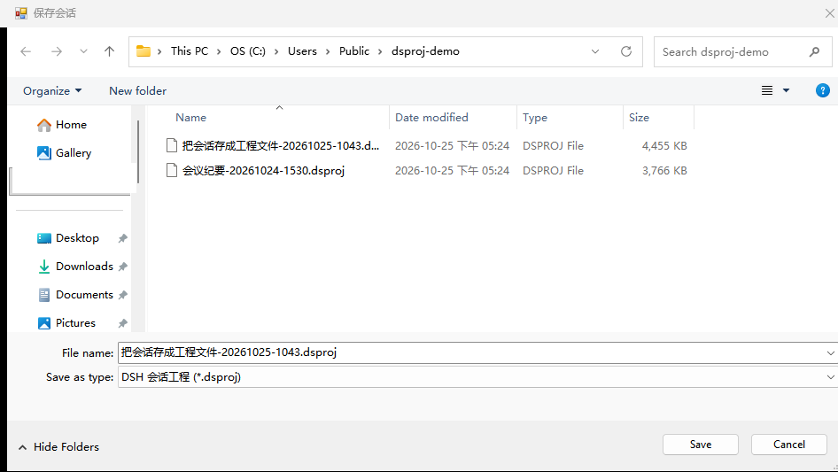
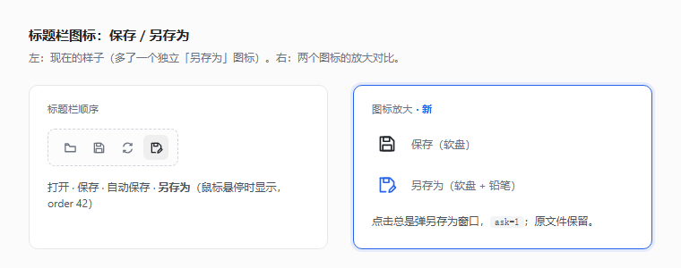
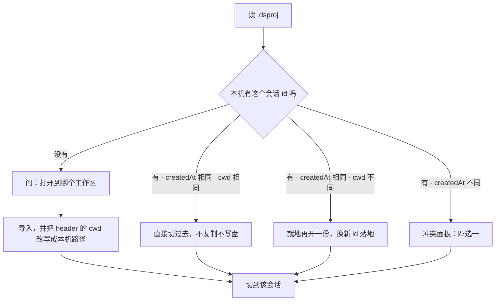

<p align="center">
  
</p>

<h1 align="center">dsh-session-save</h1>

<p align="center">
  把 DSH 会话存成一个 <code>.dsproj</code> 工程文件——像 Word 那样保存，像工程文件那样拷走。<br>
  换个 DSH、换台机器，打开这个文件就能接着上次的话题继续。
</p>

<p align="center">
  <a href="LICENSE"></a>
  
  
  <a href="https://github.com/chinacaa/dsh-session-save/stargazers"></a>
</p>

<p align="center"><a href="README.en.md">English</a> · 中文</p>



---

## 为什么需要它

DSH 把每条会话都记在 `~/.dsh/sessions/` 里，`session.v4.jsonl.zstd` 是追加写的 zstd 帧。这样做很稳，但带来三个麻烦：

- **想带走一条会话，得整目录搬。** `~/.dsh` 里有会话、记忆、附件、索引、插件状态，几个 GB 起步，搬一次等于换整台机器。
- **想存档一条对话，只能手动拷文件。** 拷完是个没有名字的 UUID 目录，过两周就想不起来它是哪次讨论。
- **两台机器轮流用，谁覆盖谁说不清。** 直接同步 `~/.dsh` 会让索引、状态、日志互相打架。

`dsh-session-save` 把这堆东西收成一个文件：**一个会话 = 一个 `.dsproj`**，名字是会话标题，里面是这条对话的全部历史加它所在工作区的记忆。发给别人、丢进网盘、归档进项目仓库，都只是"一个文件"的事。

## 它做什么

标题栏右侧多出四个图标：

| 图标 | 动作 | 说明 |
| :--: | --- | --- |
| 📁 | **打开** | 选一个 `.dsproj` → 导入 → 自动切到那个会话 |
| 💾 | **保存** | 第一次弹「另存为」，之后每点一次覆盖同一个文件 |
| 🔄 | **自动保存** | 开着的话，每步结束自动写回那个文件 |
| 📄✏️ | **另存为** | 每次都弹窗口，可以换名字或换位置，原文件保留 |

空会话页面的新会话行右侧还会多一个「打开」胶囊按钮——刚进 DSH、还没有对话时，也能直接开一个工程文件。



## 安装

```bash
# 从 npm 装
dsh plugin --profile web add dsh-session-save

# 或直接从 GitHub 装
dsh plugin --profile web add github:chinacaa/dsh-session-save
```

装完**重启 DSH**：插件在启动时组合，热装不会生效。Windows 上原生另存为窗口需要 `powershell.exe`；没有它（比如 Linux 或纯远程会话）会退回页面内的路径输入框，功能不丢。

<details>
<summary>手动安装（开发时用）</summary>

```powershell
# 1) 把仓库链接进 profile
New-Item -ItemType Junction -Path "$env:USERPROFILE\.dsh\profiles\web\node_modules\dsh-session-save" -Target "<repo>"
# 2) profile 的 package.json → dependencies 加 "dsh-session-save": "link:<repo>"
# 3) profile 的 package.json → dsh.profile.bundles 追加 "dsh-session-save"
# 4) 重启 DSH
```

别只往 profile 的 `cordis.patch.yml` 追加 `- id/name` 行——那份文件只用于**覆盖已有 id**，新增插件走 `dsh.bundle.patch` + `dsh.profile.bundles`。

</details>

## 三步用起来

1. 聊到一半点 💾（或者直接点 🔄 开自动保存，它会先替你存一次）。
2. 弹窗里确认文件名——默认是「会话标题 + 会话创建时间」，比如 `把会话存成工程文件-20261025-1043.dsproj`。
3. 之后每点一次 💾 就覆盖它；想留一份快照就点 📄✏️。

在另一台机器上：点 📁 选这个文件，会话会出现在列表里并自动切过去，接着上次的话继续说。

## 文件怎么命名

```
把会话存成工程文件-20261025-1043.dsproj
└── 会话标题 ──┘ └─ 创建时间 ─┘
```

- 标题取日志里最新的 `session/title`（DSH 自己起的那个，通常是第一句话或 LLM 的概括）。
- 时间取会话**创建**时间，不是点保存的时间——同一个会话每次另存为都得到同一个名字，不会越存越乱。
- `\ / : * ? " < > |` 和控制字符换成空格，连续空白折叠，最长 60 字。
- 还没起标题的会话退回 `20261025-1043-session-7f3a2c91.dsproj`（时间 + id 前 8 位）。
- 目录用上次保存的目录，第一次是桌面。
- **覆盖保存不改名**：记住的是完整路径，标题后来变了也不会突然冒出一个新文件。

## 打开时会发生什么

点「打开」之后，Host 侧按这个顺序判断（`importPackage()`）：



几个细节值得知道：

- **id 必须全机唯一**，所以「同一会话落到别的工作区」会换新 id（`relocate`），不会出现两份同 id 的会话。
- **工作区路径在本机不存在**时，落到 Host 的当前目录，并把会话 header 的 `cwd` 改写成本机路径；只重写 header 那一帧，其余 zstd 帧原字节照搬。
- **记忆文件按 sha256 比对**：相同跳过；不同则写成 `xxx.from-dsproj-<日期>`，**从不覆盖**本机已有记忆。
- 打开成功后，这个 `.dsproj` 会被记成该会话的「保存位置」——接着点 💾 就是存回同一个文件。

冲突面板把两边并排列出来（标题、创建时间、体积、工作区 / 导出机器），四个按钮：

| 按钮 | 做什么 |
| --- | --- |
| 取消 | 什么都不做 |
| 另存为副本 | 换新 id 落盘，两条历史都留着 |
| 用文件覆盖本机 | 先给本机那份留 `.bak-<时间戳>`，再写回同一目录 |
| 用本机的 | 只切到本机那份，不写盘 |

## 两台机器、同步盘、自动保存

这是最容易出事的地方，所以有三道防线。

**第一道：文件里的锁。** 每个包都带 `LOCK.json`：

```json
{ "format": "dshproj-lock/1", "sessionId": "…", "host": "…", "pid": 1234, "at": "2026-10-25T09:00:00.000Z", "writes": 7 }
```

`manifest.json` 里镜像一份，`SUMMARY.md` 里写明「写入者 / 锁时间」。`writes` 是这份文件的累计写入次数。

**第二道：系统里的侧车锁。** 写盘瞬间用 `<file>.lock` 以 `wx` 独占创建；抢不到就读持有者，判断是否过期。同机 pid 还活着 → 挡；异机且 `at` 在 15 分钟内 → 挡；其余可写。被挡时返回 `409 locked`，消息里点名占用者。

**第三道：内容指纹（CAS）。** 每次写完记下文件的 `sha256`；下次写之前重算，不一致说明这个文件已经被别处改过：

- 手动保存遇到 → `409 stale`，弹「这个文件已被别处改过」，三个选择：**覆盖磁盘上的** / **另存为新文件** / **取消**。
- 自动保存遇到 → **自己关掉自动保存**，这一轮不写盘。绝不用本机内容盖掉对方。

另外每次写盘都是**原子写**（先写 `<file>.tmp-<pid>-<时间戳>` 再 `rename`），同步盘不会抓到写了一半的包。路径落在 OneDrive / Dropbox / Google Drive / iCloud / 坚果云 / Box / Syncthing / Seafile / 百度网盘 时，界面会提示「两台机器同时开着自动保存会互相覆盖，建议只在一台机器上写」——只提示，不阻止。

> **一句话**：真要两台机器轮流用同一份文件，**只在一台机器上开自动保存**；另一台手动保存时，会被内容比对拦下来问你。

## 安全

打开别人的 `.dsproj` 等于让别人给你递一份压缩包，所以这个插件按「包可能是敌人」来做：

- **条目名穿越**：包里的路径逐段校验，`../../x`、`..\..\x`、盘符、UNC 一律在读包阶段拒绝；记忆文件写入时每条落点重新拼一遍并复核仍在记忆目录内。
- **落盘文件名**：`manifest.json` 里声明的会话文件名只接受 `session[.tag].jsonl[.zstd]` 形态并只取 basename，落点必须仍在 `~/.dsh/sessions` 里，已存在就不覆盖。
- **解压炸弹**：单条目上限 64 MB、整包上限 512 MB、压缩比上限 200×（4 MB 以下不算比例），并且先校验中央目录里的长度再解压。
- **写去哪儿**：保存只允许写到上次用的目录、已记住文件的目录，或原生对话框选的位置。写到别处、或者要覆盖一个不是本插件产出的文件，都要先确认。
- **路由入口**：四条 `/api` 路由只接受回环地址（`127.0.0.1` / `localhost` / `::1`）、同源 `Origin`、非 `cross-site` 请求；`sessionId` 形态校验；失败信息不回显绝对路径。
- **包完整性**：`manifest.parts` 里每条 `sha256` 与字节数逐条复核，不匹配就拒绝导入。反过来说，**内容条目（`session/`、`memory/workspaces/`）必须都在 `manifest.parts` 里声明过**——没声明的一律拒绝，这样就没法只声明会话、偷偷夹带一份 `MEMORY.md` 塞进你的项目笔记。

### 记忆：默认不带、带也只落副本

- **默认不打包记忆**。`~/.dsh/memory` 里有你的项目笔记、日志和白板，默认一个字节都不进包。要连记忆一起带走，按住 <kbd>Alt</kbd> 点保存/另存为，或请求里带 `?memory=1`。
- **包里带着记忆、在别的机器上打开，记忆默认只落成 `xxx.from-dsproj-<日期>` 副本**，DSH 不会把它当记忆读。打开后界面会报「几个文件落了副本 / 几个和本机重名」，并给一块带「合并记忆」「打开记忆目录」的提示面板。
- **「合并记忆」（`?memory=restore`）只覆盖本机已存在、且内容不同的文件**，覆盖前备份成 `xxx.bak-<时间>`；本机没有的一律**一个都不写**，只在弹窗「将新建」段里列给你看。例外只有一处：`restore` 遇到"本机有同名记忆目录、但没有这个文件名"时，会把它落成 `xxx.from-dsproj-<日期>` 副本而不是原名。
- **要把记忆铺到一台全新机器**，得在同一个弹窗里额外点「合并并新建」（`?memory=new`），这时才允许落原名。
- **为什么这么保守**：`parts` 里的 `sha256` 是**打包方自己算的**，把投毒的 `MEMORY.md` 也登记进去、哈希算对，前面所有校验都过得去——自洽不等于可信。所以「会不会被 DSH 当记忆读」只能靠改落点名来断。于是投毒最多落在两种位置：你本机本来就有、且备份看得见的那份，或者你亲手点过「合并并新建」的新文件。

## `.dsproj` 里有什么

`.dsproj` 是 `dshproj/1` 格式的 ZIP，和同名的 `dshproj` 命令行工具双向兼容（同一个包格式，工具本体不在这个仓库里）：

```
manifest.json                      会话元数据 + 每个条目的 sha256 + 锁镜像
LOCK.json                          谁写的、什么时候、写了几次
session/session.v4.jsonl.zstd       会话日志原字节（zstd 帧一个不动）
memory/workspaces/<slug>/**         该工作区的项目记忆（笔记 / 交接 / 反思）
SUMMARY.md                          人类可读摘要（ID / 工作区 / 帧数 / 行数 / 写入者）
```

不开 DSH 也能用同一个格式离线处理：

```bash
dshproj verify   会话.dsproj                      # 校验帧结构与条目 sha256
dshproj info     会话.dsproj                      # 看标题、帧数、记忆文件数
dshproj import   会话.dsproj --cwd D:\elsewhere   # 导进另一个工作区（换新 id）
```

不打包工作区里的代码文件——`.dsproj` 只带会话与记忆。要把代码一起带走用 `dshproj export --files`。

## 常见问题

**保存的是我这句话吗？** 保存的是**此刻已落盘**的内容；正在生成的这一步可能还差最后一帧，等它结束再点一次就齐了。

**自动保存会不会很占磁盘？** 每步整包重写（会话日志追加写，但包要重新打包），1.5 秒去抖把频率压到每步最多一次。会话特别大时建议只手动保存。

**能在 Linux / macOS 上用吗？** Host 侧逻辑与平台无关，另存为窗口走 PowerShell——没有它时退回页面内的路径输入框，功能完整。

**会覆盖我的项目记忆吗？** 默认连记忆都不打包；带记忆打开时一律落 `xxx.from-dsproj-<日期>` 副本；「合并记忆」只覆盖本机已有文件，覆盖前留 `.bak-<时间>`。

**打开后为什么换了 id？** 因为 id 必须在一个 `DSH_HOME` 内唯一：同一个会话换工作区落地会重新发一个 id，两条历史都在。

**能只导出不导入吗？** 能。`.dsproj` 就是 ZIP，`dshproj verify/info` 都能离线读。

## 兼容与版本

| 项 | 版本线 | 什么时候动 |
| --- | --- | --- |
| 包版本 | `package.json` 的 `version`（SemVer） | `0.x` 时 MINOR 可破坏，PATCH 只修 bug |
| 包格式 | `dshproj/1`（`index.js` 的 `FORMAT`） | 包内布局变了才动，要照顾 `dshproj` 命令行 |
| 锁格式 | `dshproj-lock/1`（`LOCK_FORMAT`） | `LOCK.json` 字段变了才动 |
| 宿主范围 | `engines.dsh`、peer `@deepseek-ai/cordis` | 用了新 API 或官方包抬了下界 |

改版本用脚本，别手改（它会同步 `CHANGELOG.md`）：

```bash
node scripts/bump.mjs patch     # 修 bug
node scripts/bump.mjs minor     # 新功能
node scripts/bump.mjs major     # 破坏性
```

## 开发

零运行时依赖，纯 ESM，只用 `node:` 内置模块；客户端只依赖 `react`。

```bash
node --check index.js client.js   # 语法
node test/client.mjs              # 客户端接线：五个插槽项、图标指纹、点击打到的路由（含英文词表）
node test/smoke.mjs               # 打包冒烟：夹具会话 → 打包 → 回读 ZIP → 二次保存复用路径
node test/open.mjs                # 打开链路：复用 / 换 cwd 落地 / 问工作区 / 逐帧比对
node test/conflict.mjs            # 锁、四种冲突、CAS、自动保存（约 30 秒）
node test/dialog.mjs              # 中文路径往返：PowerShell 结果文件 + UTF-8
node test/security.mjs            # 安全回归：条目名穿越 / 落点文件名 / 解压炸弹 / 路由闸 / 包校验
```

改客户端后想验英文词表：`DSH_TEST_LOCALE=en-US node test/client.mjs`。

六套测试全部跑在自己的临时 `DSH_HOME`（`test/fixture.mjs` 在 `os.tmpdir()` 下建的夹具目录）里，跑完自动删掉，**不碰真实的 `~/.dsh`**，也不要求本机"恰好有会话"。

两套例外：`test/client.mjs` 是纯内存接线测试，不建夹具目录也不读写磁盘；`test/dialog.mjs` 起真实 `powershell.exe` 验编码，没有 PowerShell 的机器跑不了，其余五套跨平台。

想改代码先读 [`AGENTS.md`](AGENTS.md)：红线、四条路由的契约、`importPackage` 的分支顺序、测试怎么写，都在那里；[`CLAUDE.md`](CLAUDE.md) 是最短入口，[`docs/TEST-MATRIX.md`](docs/TEST-MATRIX.md) 是功能面与测试的对照表。

## 已知边界

- 打开只认本插件与 `dshproj` 产出的 `dshproj/1` 包；包里没有 `session/` 条目会直接报错，不会造一个空会话。
- 切会话依赖 `uiWorkspace.openSession`；某个前端没有这个服务时（例如纯 TUI），会话仍会被导入并出现在列表里，只是不会自动跳转。
- 跨机锁只按 15 分钟时间窗判断，不是实时心跳：另一台机器刚写完但没来得及清锁，最多挡 15 分钟。
- 单机多实例共用一个 `DSH_HOME` 时，`storages/session-save.json` 会被后写的覆盖，但每个会话记住的路径仍各自独立。
- 「打开到哪个工作区」的列表来自 `storages/workspace.json`；全新机器上该文件不存在，列表为空，只能走「选其他目录…」。
- 空会话页面的「打开」按钮只出现在还没有消息的新会话上；进入对话后要打开别的工程，用标题栏那个 📁。
- 默认不打包工作区记忆；带了记忆的包打开后也只落副本，要用户显式点「合并记忆」/「合并并新建」才会被 DSH 读到（见上一节）。
- 只在回环地址上工作：通过反向代理或另一台机器的浏览器访问本机 DSH 时，四条会话路由会被 403 挡掉（这是有意的）。

## 许可

MIT © 2026 chinacaa · 见 [LICENSE](LICENSE)
